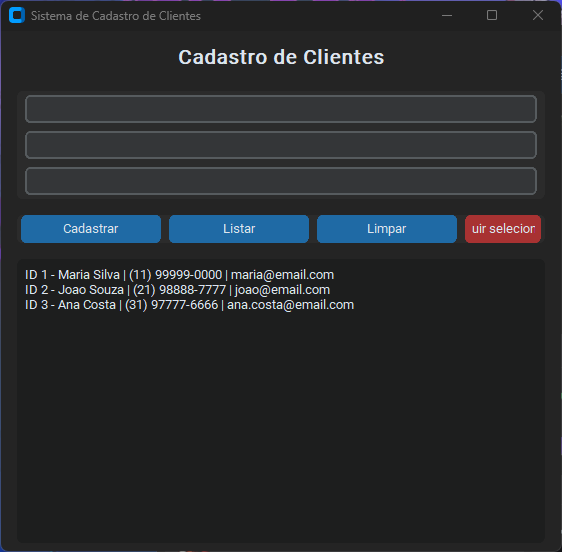

# Sistema de Cadastro (CRUD) - 4 Etapas

Projeto para aprender programação na prática, evoluindo do console até uma interface gráfica.

## Objetivo

Criar um sistema simples de cadastro de clientes (nome, telefone e email) e evoluir ele em 4 etapas, resolvendo um problema por vez:

1. Fazer o cadastro funcionar (console, dados em memória)
2. Não perder os dados ao fechar o programa (arquivo `.txt`)
3. Guardar os dados de forma organizada (banco SQLite)
4. Deixar o sistema fácil de usar para quem não conhece terminal (interface gráfica)

## Minha contribuição

Projeto individual. Planejei as etapas, escrevi o código e testei cada versão.

| Etapa | O que fiz | O que aprendi |
|---|---|---|
| **1 - Console** | Menu com cadastrar, listar, buscar e excluir. Clientes guardados numa lista de dicionários. | Variáveis, listas, loops, funções, condicionais |
| **2 - Arquivo** | Os dados passam a ser salvos em `clientes.txt` (uma linha por cliente, separado por `\|`) e carregados ao abrir. | `open()`, leitura e escrita de arquivos |
| **3 - SQLite** | Troquei o arquivo por um banco `clientes.db` com tabela e ID automático. Adicionei a opção **atualizar**. | SQL: INSERT, SELECT, UPDATE, DELETE |
| **4 - Interface** | Janela com campos e botões usando `customtkinter`, salvando no mesmo banco da etapa 3. | Interface gráfica, eventos de botão |

**Decisões que tomei:**
- **Uma etapa por arquivo:** dá para comparar as versões e ver a evolução do código.
- **Nome obrigatório:** o sistema não deixa cadastrar cliente sem nome.
- **Busca por parte do nome e sem diferenciar maiúscula/minúscula:** quem busca "maria" encontra "Maria Silva".
- **SQL com `?` em vez de juntar texto:** evita erro e SQL injection quando o nome tem aspas.
- **Confirmação antes de excluir** na interface, para não apagar cliente sem querer.

## Evidências

### Etapa 2: os dados continuam depois de fechar o programa
Cadastrei um cliente, fechei o programa, abri de novo e listei:

```
--- Lista de Clientes ---
1. Nome: Maria Silva | Tel: 11999990000 | Email: maria@email.com
```

Conteúdo do `clientes.txt` gerado:
```
Maria Silva|11999990000|maria@email.com
```

### Etapa 3: CRUD completo no banco
Cadastrei 2 clientes, atualizei o email do João e excluí a Maria:

```
--- Lista de Clientes ---
ID 1 | Nome: Maria Silva | Tel: 11999990000 | Email: maria@email.com
ID 2 | Nome: Joao Souza | Tel: 21988887777 | Email: joao.souza@email.com

ID do cliente para excluir (0 para cancelar): Cliente removido.

--- Lista de Clientes ---
ID 2 | Nome: Joao Souza | Tel: 21988887777 | Email: joao.souza@email.com
```

### Etapa 4: interface gráfica
<!-- Coloque aqui um print da janela:  -->

## Estrutura

| Arquivo                | Etapa   | O que aprende                                              |
|------------------------|---------|------------------------------------------------------------|
| `etapa1_console.py`    | Etapa 1 | Variáveis, listas, loops, funções, condicionais           |
| `etapa2_arquivo.py`    | Etapa 2 | `open()` - persistência em `clientes.txt`                  |
| `etapa3_sqlite.py`     | Etapa 3 | `sqlite3` - INSERT, SELECT, UPDATE, DELETE                 |
| `etapa4_interface.py`  | Etapa 4 | `customtkinter` - botões, campos, janela                    |

## Como rodar

### Etapas 1, 2 e 3 (apenas Python padrão)
```bash
python etapa1_console.py
python etapa2_arquivo.py
python etapa3_sqlite.py
```

### Etapa 4 (interface)
```bash
pip install customtkinter
python etapa4_interface.py
```

## O que o sistema faz
- Cadastrar cliente (Nome, Telefone, Email)
- Listar clientes
- Buscar cliente
- Atualizar cliente (etapa 3)
- Excluir cliente
- Sair

## Evolução

- **Etapa 1** → tudo em memória (some ao fechar)
- **Etapa 2** → salva em `clientes.txt` (texto puro)
- **Etapa 3** → banco SQLite `clientes.db` (banco de dados real)
- **Etapa 4** → interface gráfica amigável com `customtkinter`

## Limitações e próximos passos

- [ ] A interface ainda não tem **buscar** e **atualizar** (só existem no console da etapa 3)
- [ ] Para excluir na interface é preciso selecionar o texto da linha; trocar por uma tabela clicável
- [ ] Validar o formato do email e do telefone
- [ ] Impedir cadastro duplicado (mesmo email)
