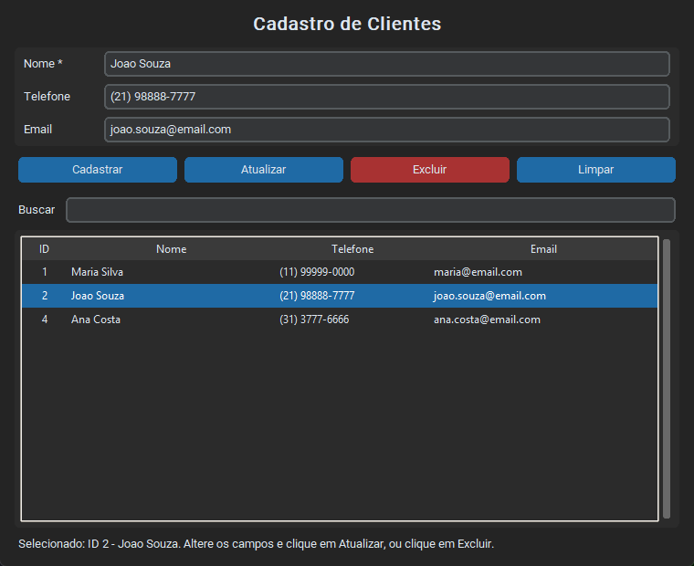
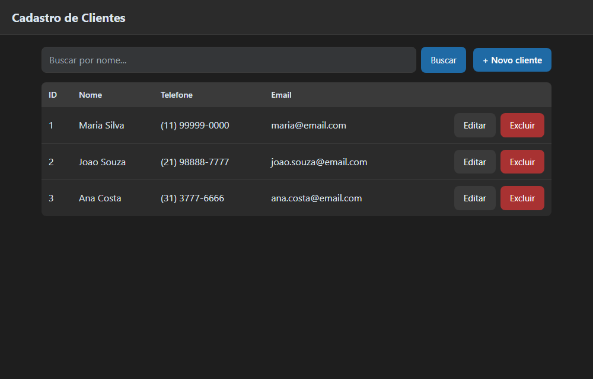
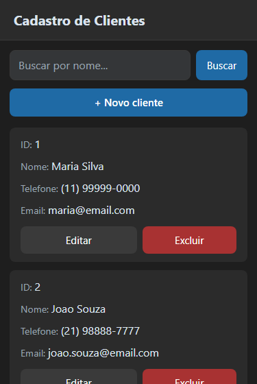

# Sistema de Cadastro (CRUD) - 5 Etapas

Projeto para aprender programação na prática, evoluindo do console até uma interface gráfica e uma versão web.

## Objetivo

Criar um sistema simples de cadastro de clientes (nome, telefone e email) e evoluir ele em etapas, resolvendo um problema por vez:

1. Fazer o cadastro funcionar (console, dados em memória)
2. Não perder os dados ao fechar o programa (arquivo `.txt`)
3. Guardar os dados de forma organizada (banco SQLite)
4. Deixar o sistema fácil de usar para quem não conhece terminal (interface gráfica)
5. Usar pelo navegador, inclusive no celular (versão web com Flask)

## Minha contribuição

Projeto individual. Planejei as etapas, escrevi o código e testei cada versão.

| Etapa | O que fiz | O que aprendi |
|---|---|---|
| **1 - Console** | Menu com cadastrar, listar, buscar e excluir. Clientes guardados numa lista de dicionários. | Variáveis, listas, loops, funções, condicionais |
| **2 - Arquivo** | Os dados passam a ser salvos em `clientes.txt` (uma linha por cliente, separado por `\|`) e carregados ao abrir. | `open()`, leitura e escrita de arquivos |
| **3 - SQLite** | Troquei o arquivo por um banco `clientes.db` com tabela e ID automático. Adicionei a opção **atualizar**. | SQL: INSERT, SELECT, UPDATE, DELETE |
| **4 - Interface** | Janela com campos e botões usando `customtkinter`, salvando no mesmo banco da etapa 3. | Interface gráfica, eventos de botão |
| **4.1 - Melhorias na interface** | Buscar e atualizar na janela, tabela clicável no lugar da caixa de texto, validação de email/telefone, bloqueio de duplicados e correção do botão cortado e das dicas que sumiam. | `ttk.Treeview`, layout com `grid`, expressões regulares, foco de campos |
| **5 - Web** | Páginas em HTML e CSS com Flask, usando o mesmo banco. Funciona no computador e no celular. | Rotas, formulários GET/POST, templates Jinja, CSS responsivo |

**Decisões que tomei:**
- **Uma etapa por arquivo:** dá para comparar as versões e ver a evolução do código.
- **Nome obrigatório:** o sistema não deixa cadastrar cliente sem nome.
- **Busca por parte do nome e sem diferenciar maiúscula/minúscula:** quem busca "maria" encontra "Maria Silva".
- **SQL com `?` em vez de juntar texto:** evita erro e SQL injection quando o nome tem aspas.
- **Confirmação antes de excluir** na interface e na web, para não apagar cliente sem querer.
- **Telefone e email padronizados ao salvar:** `11999990000` vira `(11) 99999-0000` e o email fica em minúsculas. Assim a checagem de duplicados funciona mesmo que a pessoa digite de jeitos diferentes.
- **Duplicado = mesmo email ou mesmo telefone** de outro cliente. Nomes iguais são permitidos (existem duas "Maria Silva").
- **Excluir na web só por formulário (POST):** um link (GET) poderia apagar um cliente só de ser aberto.

## Evidências

### Etapa 2: os dados continuam depois de fechar o programa
Cadastrei um cliente, fechei o programa, abri de novo e listei:

```
--- Lista de Clientes ---
1. Nome: Maria Silva | Tel: 11999990000 | Email: maria@email.com
```

Conteúdo do `clientes.txt` gerado:
```
Maria Silva|11999990000|maria@email.com
```

### Etapa 3: CRUD completo no banco
Cadastrei 2 clientes, atualizei o email do João e excluí a Maria:

```
--- Lista de Clientes ---
ID 1 | Nome: Maria Silva | Tel: 11999990000 | Email: maria@email.com
ID 2 | Nome: Joao Souza | Tel: 21988887777 | Email: joao.souza@email.com

ID do cliente para excluir (0 para cancelar): Cliente removido.

--- Lista de Clientes ---
ID 2 | Nome: Joao Souza | Tel: 21988887777 | Email: joao.souza@email.com
```

### Etapa 4: interface gráfica (primeira versão)
3 clientes cadastrados pela janela e listados com o botão **Listar**. O print mostrou dois problemas: o botão "Excluir selecionado" cortado e os campos sem o texto de dica.


### Etapa 4.1: interface melhorada
Clicando num cliente, os campos são preenchidos para **atualizar** ou **excluir**. A busca filtra a tabela enquanto digita, e todos os botões aparecem inteiros.



Testei também os casos de erro. Todos mostram aviso e não salvam:
- email repetido: *"Já existe um cliente com este email: ID 1 - Maria Silva."*
- telefone repetido, telefone com poucos dígitos (`1234`) e email sem `@`
- nome vazio

Depois de cadastrar ou clicar em **Limpar**, as dicas (*Ex.: Maria Silva*...) voltam a aparecer nos campos.

### Etapa 5: versão web
Lista com busca, botões de editar/excluir e cadastro em outra página:



No celular, cada cliente vira um cartão:



## Estrutura

| Arquivo                | Etapa   | O que aprende                                              |
|------------------------|---------|------------------------------------------------------------|
| `etapa1_console.py`    | Etapa 1 | Variáveis, listas, loops, funções, condicionais           |
| `etapa2_arquivo.py`    | Etapa 2 | `open()` - persistência em `clientes.txt`                  |
| `etapa3_sqlite.py`     | Etapa 3 | `sqlite3` - INSERT, SELECT, UPDATE, DELETE                 |
| `etapa4_interface.py`  | Etapa 4 | `customtkinter` - botões, campos, tabela, validação       |
| `etapa5_web.py`        | Etapa 5 | `flask` - rotas, formulários, templates                    |
| `templates/`           | Etapa 5 | Páginas HTML (lista e formulário)                          |
| `static/style.css`     | Etapa 5 | Visual da versão web (computador e celular)                |

## Como rodar

### Etapas 1, 2 e 3 (apenas Python padrão)
```bash
python etapa1_console.py
python etapa2_arquivo.py
python etapa3_sqlite.py
```

### Etapas 4 e 5
```bash
pip install -r requirements.txt
python etapa4_interface.py     # janela
python etapa5_web.py           # abra http://127.0.0.1:5000 no navegador
```

Para abrir a versão web no celular (mesma rede Wi-Fi), rode `python etapa5_web.py --rede` e acesse `http://<IP do computador>:5000`.

As etapas 3, 4 e 5 usam o mesmo `clientes.db`: um cliente cadastrado na janela aparece na web e vice-versa.

## O que o sistema faz
- Cadastrar cliente (Nome, Telefone, Email)
- Listar clientes
- Buscar cliente por parte do nome
- Atualizar cliente (etapas 3, 4 e 5)
- Excluir cliente (com confirmação)
- Validar email e telefone e impedir duplicados (etapas 4 e 5)

## Evolução

- **Etapa 1** → tudo em memória (some ao fechar)
- **Etapa 2** → salva em `clientes.txt` (texto puro)
- **Etapa 3** → banco SQLite `clientes.db` (banco de dados real)
- **Etapa 4** → interface gráfica amigável com `customtkinter`, depois com tabela, busca, atualização e validação
- **Etapa 5** → versão web com Flask, acessível pelo navegador e pelo celular

## Limitações e próximos passos

- [x] Etapa 5 - versão web (HTML + CSS + Flask, usando o mesmo banco SQLite), sugestão do feedback de um colega
- [x] Buscar e atualizar na interface
- [x] Tabela clicável para excluir (no lugar de selecionar o texto da linha)
- [x] Validar o formato do email e do telefone
- [x] Impedir cadastro duplicado (mesmo email ou telefone)
- [x] Botão "Excluir selecionado" cortado
- [x] Campos perdendo o texto de dica depois de cadastrar
- [ ] A versão web não tem login: qualquer pessoa na mesma rede pode mexer nos dados quando ela roda com `--rede`
- [ ] Clientes cadastrados antes da validação (etapas 1 a 3) podem ter telefone sem formatação ou duplicados
- [ ] As regras de validação estão repetidas nas etapas 4 e 5 (cada etapa funciona sozinha); o próximo passo seria um módulo compartilhado
- [ ] Telefone aceita só o formato brasileiro (DDD + 8 ou 9 dígitos)
